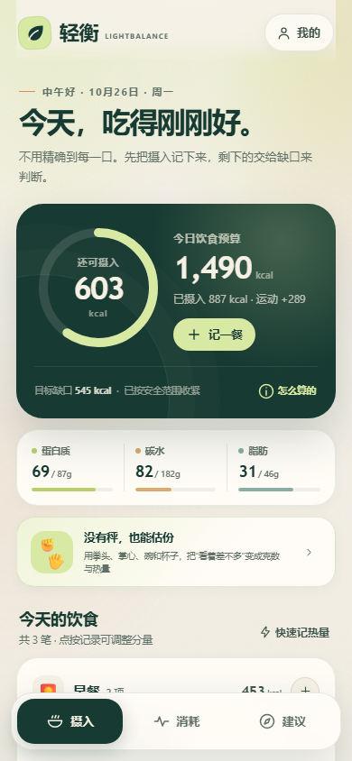
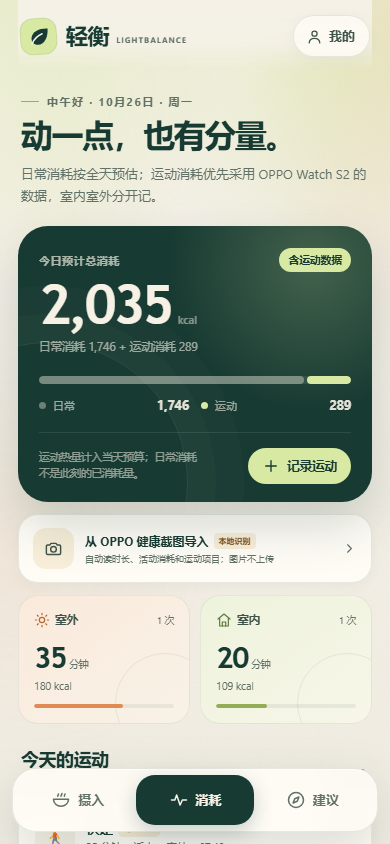
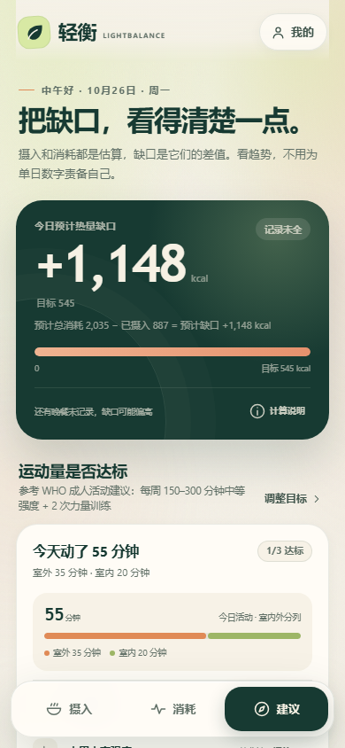
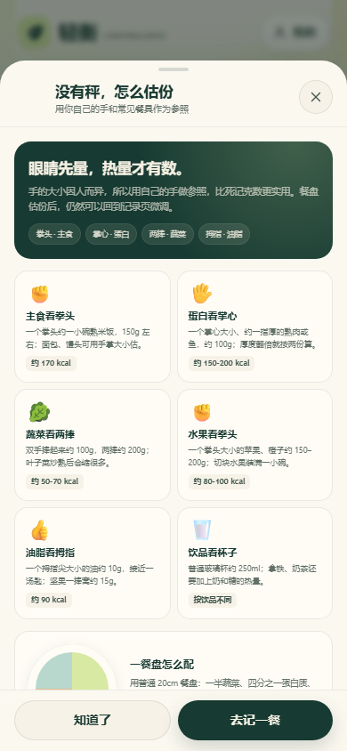
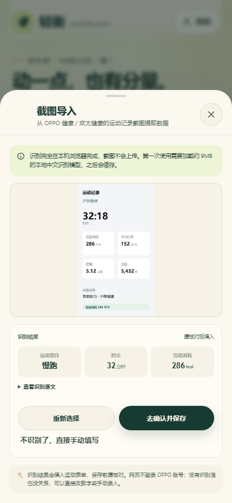

# 轻衡 · LIGHTBALANCE

手机端减脂能量账本：记录饮食与运动，用全天消耗减去摄入，得到看得见的热量缺口，再把缺口变成“吃一点 / 动一点”的下一步。

在线使用：<https://lzk6186-bot.github.io/lightbalance/>

安装方式：在手机浏览器打开上面的 HTTPS 地址，进入「我的 → 手机桌面」；Android Chrome 可以直接安装，iPhone 用 Safari 的“分享 → 添加到主屏幕”。

## 功能

- **摄入**：90+ 常见食物、按克数记录、自定义食物、快速记热量，以及蛋白质 / 碳水 / 脂肪进度。
- **无秤视觉估份**：用手掌、拳头、碗、杯子和餐盘做参照，直接估算克数和热量；食物记录页有可点选的视觉份量卡。
- **消耗**：日常消耗与运动消耗分开算；运动分室内 / 室外；支持截图导入或手动录入 OPPO Watch S2 的活动消耗。
- **截图 OCR 导入**：从 OPPO 健康 / 欢太健康的运动记录截图提取运动类型、时长和活动消耗。OCR 在浏览器本地运行，截图不上传；识别后仍需你核对。
- **建议**：热量缺口、运动达标（今日活动 / 本周中高强度 / 力量训练）、缺口补给、按剩余预算生成食谱，以及近 7 天缺口趋势。
- **本地优先**：无需登录，所有记录仅保存在当前浏览器的 `localStorage`，可导出 JSON 备份。
- **PWA**：HTTPS 下可添加到手机桌面并离线打开已缓存的核心页面。

## 界面

| 摄入 | 消耗 | 建议 |
| --- | --- | --- |
|  |  |  |

## OPPO Watch S2 说明

网页无法直接读取 OPPO 健康 / 欢太健康的数据，因此这里没有做“自动同步”的假入口。实际方式是：

1. 在手表或欢太健康打开一次运动记录；
2. 截图，或手动抄下“活动消耗”和时长；
3. 在轻衡点「从 OPPO 健康截图导入」，核对识别结果后保存。

截图 OCR 使用本地的 Tesseract.js 中文模型。首次使用需要加载约 9MB 的识别运行时，之后会缓存；图片不会发送到服务器。识别属于辅助录入，复杂或模糊截图可能识别不准，保存前可以修改。

## 计算

- 基础代谢：Mifflin–St Jeor；
- 日常消耗：BMR × 活动系数，不含专门运动；
- 运动热量：截图 / 手填优先，留空时按 MET × 3.5 × 体重 ÷ 200 × 分钟估算；
- 饮食预算：预计总消耗 − 目标缺口；
- 热量缺口：预计总消耗 − 已摄入。

安全边界：女性 / 男性饮食预算下限为 1200 / 1500 kcal，目标缺口最大 750 kcal/天；目标 BMI 不低于 18.5。工具面向 18–75 岁健康成年人，不构成医疗或营养处方。

## 技术

纯静态、无后端、无运行时第三方框架依赖。Tesseract.js 与中文 `chi_sim` 模型作为 OCR 可选依赖放在 `vendor/tesseract`，仅在截图识别时按需加载；对应 Apache-2.0 许可证随附。

数据与代码均不上传；如果你自行部署，只需把这些文件放到任意 HTTPS 静态托管即可。
